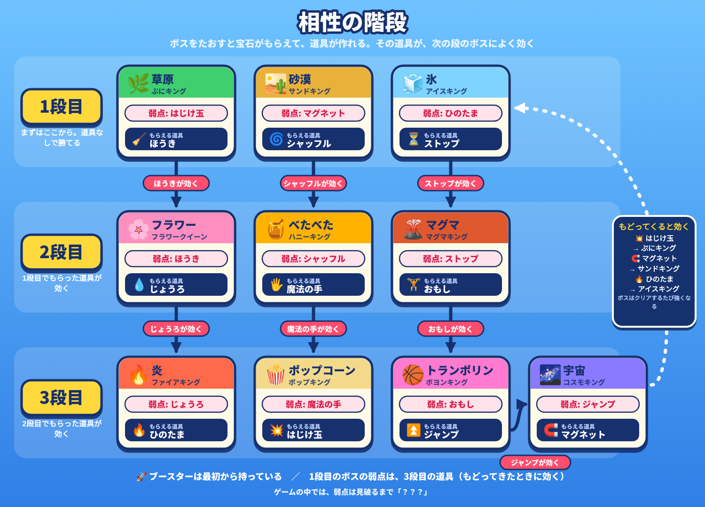

# グラビティ・ポップ 仕様書（EARS形式）

- 対象: `free.html`（ゲーム本体）。iOSアプリ側（広告・課金）は最後の章に概要だけ。
- 用語は [GLOSSARY.md](GLOSSARY.md) にそろえる。
- 各要件には番号がある。`tests/` のテストは docstring に同じ番号を書いて対応させる。
- 「テスト」の列が「—」の要件は、まだ自動テストがない。

## 書き方（EARS）

| 型 | 書き方 |
|---|---|
| いつも | ゲームは〜する。 |
| できごと | 〜したとき、ゲームは〜する。 |
| 状態 | 〜の間、ゲームは〜する。 |
| 望ましくないこと | もし〜ならば、ゲームは〜する。 |
| 条件つきの機能 | 〜の場合、ゲームは〜する。 |

---

## 1. ぷにと消し方（PUNI / CHAIN）

| 番号 | 要件 | テスト |
|---|---|---|
| PUNI-01 | 同じ色のふつうのぷにが5個以上つながったとき、ゲームはそれらを消す。 | test_world::test_pop_needs_five |
| PUNI-02 | もしつながった同じ色のぷにが4個以下ならば、ゲームはそれらを消さない。 | test_world::test_pop_needs_five |
| PUNI-03 | はなぷにが3個以上つながったとき、ゲームはそれらを消す。ゲームは、はなぷにを、はなぷに以外とつなげない。 | test_world::test_flower |
| PUNI-04 | はなぷにが消えたとき、ゲームは4.5秒間、花びらで盤面を見えにくくする。 | test_world::test_flower |
| PUNI-05 | マグマぷにがほかのぷににふれたとき、ゲームは0.9秒後に、まわり（半径1.35マス）のぷにごと燃やして取りのぞく。ゲームは、燃えたぷにを、消した数・スコア・連鎖・エネルギー・ボスへのダメージに数えない。 | test_world::test_magma_burn_not_counted |
| PUNI-06 | ぷにが消えたとき、ゲームは、それにふれているお邪魔ぷにもいっしょに消し、1個につき20点を加える。 | — |
| PUNI-07 | ゲームは、2個の組を2色までで、3個以上の組を3色で出す。 | — |
| PUNI-08 | ワールドに固有のぷにがある場合、ゲームはそのぷにを多めに出す（基準の割合 0.55）。 | — |
| CHAIN-01 | ぷにが消えたとき、ゲームは 2秒+0.5秒×(連鎖数−1)（最大4.5秒）の間、次の連鎖を受けつける。ブースターが効いている間、ゲームはこの時間を2倍にする。 | test_world::test_chain_window |
| CHAIN-02 | 3連鎖になったとき、および消した数が50個ふえるごとに、ゲームはごほうび（EN-05）を出す。 | — |

## 2. ワールドとステージ（WORLD）

| 番号 | 要件 | テスト |
|---|---|---|
| WORLD-01 | ゲームは、10のワールドすべてを、最初からえらんで始められるようにする。 | test_world::test_all_worlds_open, test_world::test_world_select_shows_ten |
| WORLD-02 | ゲームは、1つのワールドを5つのステージで構成し、5ステージ目に入ったときボスを出す。 | test_world::test_stage_up_and_boss |
| WORLD-03 | ステージで消した数が 45+6×クリア回数（クリア回数は8回ぶんまで、上限90）に達したとき、ゲームは次のステージに進める。 | test_world::test_stage_need |
| WORLD-04 | 5ステージ目の間、ゲームは、消した数ではステージを進めず、ボスを倒したときだけワールドクリアにする。 | test_world::test_stage_up_and_boss |
| WORLD-05 | ワールドクリアしたとき、ゲームは、そのワールドのクリア回数を1ふやし、ライフを1つもどし、コイン（プレイのぶん+50+10×ワールド番号）を与える。 | test_boss::test_defeat_and_rewards |
| WORLD-06 | もし出口がふさがって次の組が出られない状態が3秒ぶん続いたならば、ゲームはゲームオーバーにする。山が動いている間、ゲームはこのカウントを3分の1ほどの速さで進める。 | test_world::test_game_over_when_exit_blocked |
| WORLD-07 | ゲームは、ワールドをえらぶ画面で、ワールドを相性の階段（7章の相性表）の段ごとに、1段目・2段目・3段目の順で上からならべる。段の中の順は相性表のとおりにする（1段目: 草原・砂漠・氷、2段目: フラワー・べたべた・マグマ、3段目: 炎・ポップコーン・トランポリン・宇宙）。ゲームは、段ごとに小さな見出し（「1段目」「2段目」「3段目」）と、ひとこと（1段目「まずはここから」、2段目「1段目の道具が効く」、3段目「2段目の道具が効く」）をつける。 | test_world::test_world_select_tiers |
| WORLD-08 | ゲームは、ワールドをえらぶ画面で、ランダムのカード（全部のワールドをクリアするまではカギつき）を、3段目のあとの最後に置く。 | test_world::test_world_select_tiers |
| WORLD-09 | ゲームは、ワールドをえらぶ画面のならび順によって、ワールドの番号（「ステージ 9-1」のような表示、クリアのコインの計算 WORLD-05）を変えない。カードをえらんだとき、ゲームはそのカードのワールドを始める。 | test_world::test_world_numbers_unchanged |

## 3. ライフと放置（LIFE / IDLE）

| 番号 | 要件 | テスト |
|---|---|---|
| LIFE-01 | プレイを始めたとき、ゲームはライフを1つへらす。 | test_world::test_life |
| LIFE-02 | もしライフが0ならば、ゲームはプレイを始めず、ライフ回復の画面を出す。 | test_world::test_life |
| LIFE-03 | ゲームは、ライフを最大5とし、20分ごとに1つ回復する。 | — |
| LIFE-04 | ライフ回復の画面でコイン100を払ったとき、ゲームはライフを全回復する。 | — |
| IDLE-01 | プレイ中に5秒間操作がなかったとき、ゲームは「うごかして！」と注意を出す（盤面の大きな文字と、実況ぷにの吹き出し TALK-08）。 | test_world::test_idle_garbage, test_talk::test_everyday_lines |
| IDLE-02 | プレイ中に8秒間操作がなかったとき、ゲームは出口の左右からお邪魔ぷにを降らせる。その後も操作がなければ、6秒ごとに数をふやして（片側最大4個）降らせる。 | test_world::test_idle_garbage |
| IDLE-03 | ゲームは、タップ・キー入力・傾きの変化（0.10以上）を操作とみなす。 | — |

## 4. エネルギー（EN）

| 番号 | 要件 | テスト |
|---|---|---|
| EN-01 | プレイを始めたとき、ゲームはエネルギーを 40+スターの合計数 にする（STAR-07。スターが0なら40）。エネルギーの上限は 100+2×スターの合計数 とする（STAR-06。スターが0なら100）。 | test_energy::test_start_energy, test_star::test_star_energy |
| EN-02 | ゲームは、プレイを始めたときにエネルギー缶を使わない（持っている缶をへらさない）。缶を持っていても、開始時のエネルギーは EN-01 のとおりにする。 | test_energy::test_can_not_used_at_start, test_star::test_star_energy |
| EN-03 | ぷにを消したとき、ゲームは1個につきエネルギーを1ふやす。 | test_energy::test_pop_gives_energy |
| EN-04 | ゲームは、エネルギーが上限（EN-01）をこえないようにする。 | test_energy::test_energy_cap, test_star::test_star_energy |
| EN-05 | ごほうびが出たとき、ゲームはエネルギーを20ふやす。 | test_energy::test_bonus_energy |
| EN-06 | ゲームは、Lv1のアイテムの消費エネルギーを下の表のとおりにする（11種）。 | test_energy::test_cost_lv1 |
| EN-07 | ゲームは、アイテムのレベルが1上がるごとに、消費エネルギーをLv1の1割ずつふやす（四捨五入。Lv5でLv1の1.4倍）。 | test_energy::test_cost_grows_with_level |
| EN-08 | もしエネルギーが消費エネルギーに足りないならば、ゲームはそのアイテムを使わせず、エネルギーもへらさない（実況ぷにが知らせる。TALK-09）。 | test_energy::test_not_enough_energy, test_talk::test_energy_short |
| EN-09 | アイテムを使ったとき、ゲームは消費エネルギーのぶんだけエネルギーをへらす。 | test_energy::test_use_spends_energy |
| EN-10 | ゲームは、アイテムのボタンに消費エネルギーを表示する（エネルギー缶のボタンは EN-16）。 | test_energy::test_badge_shows_cost |
| EN-11 | ゲームは、盤面の右のふちに、短い横棒を積み上げた目盛りのゲージ（100につき25本）でエネルギーを表示する。棒の色は、0を赤・上限を緑とするグラデーションにする。ゲームは、いまの先頭のマスを、ぷにの形（バーと同じ幅）で表示する。 | — |
| EN-12 | エネルギーの上限が100をこえる場合、ゲームは100をこえたぶんを2巡目として、同じ棒の下から重ねて表示する（横にははみ出さない）。色のグラデーションは上限全体に引きのばす。 | — |
| EN-13 | ゲームは、ボタンの消費エネルギーの表示（バッジ）を、となりのアイテムのボタンに隠れないように、いつも手前に表示する。 | test_energy::test_badge_not_hidden |
| EN-14 | プレイ中にエネルギー缶のボタンを押したとき、ゲームは、缶を1本へらして保存し、エネルギーを上限（EN-01）まで満タンにし、そのプレイで缶を使ったことを記録する（STAR-03）。ゲームは、使ったことが分かる演出（ゲージの光・アイコン・効果音）を出す。 | test_energy::test_can_fills_energy |
| EN-15 | もしエネルギーがすでに上限まで満タンであるか、缶を1本も持っていないならば、ゲームはエネルギー缶を使わせず、缶もへらさない。 | test_energy::test_can_not_usable |
| EN-16 | ゲームは、エネルギー缶のボタンに、消費エネルギーの代わりに、持っている本数（「×2」のように）を表示する。缶を使えない間（EN-15）、ゲームはそのボタンを、エネルギーが足りないアイテムと同じ「使えない見た目」にする。 | test_energy::test_can_badge |

| アイテム | ジャンプ | ストップ | ブースター | シャッフル | マグネット | 魔法の手 | ほうき | はじけ玉 | おもし | ひのたま | じょうろ |
|---|---|---|---|---|---|---|---|---|---|---|---|
| 消費（Lv1） | 20 | 30 | 30 | 35 | 40 | 40 | 25 | 35 | 30 | 35 | 30 |

## 5. アイテム（ITEM）

| 番号 | 要件 | テスト |
|---|---|---|
| ITEM-01 | ゲームは、最初はブースターだけを使えるようにする。ほかのアイテムは開発（LAB-01）したあと使えるようにする。 | test_items::test_only_boost_at_first |
| ITEM-02 | 時間で効くアイテムを使ったとき、ゲームは次の時間だけ効果を続ける: ストップ6秒、マグネット6秒、ブースター15秒、魔法の手5秒、おもし8秒。 | test_items::test_durations |
| ITEM-03 | アイテムの効果が続いている間、ゲームは同じアイテムを重ねて使わせない。 | test_items::test_no_stack |
| ITEM-04 | ほかのアイテムの効果中にストップを使ったとき、ゲームはその効果を元の長さの2割だけのばす。ゲームは、これを1回の効果につき1度だけ行う（マグネット・ブースター・魔法の手・おもしが対象）。 | test_items::test_stop_extends_others, test_items::test_stop_extends_weight |
| ITEM-05 | ジャンプを使ったとき、ゲームは止まっているぷにを全部、3〜8マスの高さにはね上げる。 | — |
| ITEM-06 | シャッフルを使ったとき、ゲームは止まっているぷにのうち決まった割合（Lv1で6割）を吸いこみ、空いている場所にばらまき直す。ゲームは、えらばれなかったぷにをその場に残す。ゲームは、巻きこんだぷにの状態（べたべた など）を、そのまま残す（ハニーキングに効いたときをのぞく。BOSS-15）。 | test_items::test_shuffle_rate, test_boss::test_shuffle_shakes_off_honey |
| ITEM-07 | 魔法の手が効いている間、ゲームは、指でつかんだぷに（つながった仲間ごと）を運べるようにする。 | — |
| ITEM-08 | 時間で効くアイテム（ストップ・マグネット・ブースター・魔法の手・おもし）が効いている間、ゲームはそのボタンに残り時間を白い扇形で表示する。 | test_items::test_weight_clock |
| ITEM-09 | ほうきを使ったとき、ゲームは、止まっているぷにから べたべた・感染・時限の状態を取りのぞいて、ふつうのぷにに戻す。ゲームは、べたべたでくっついていた違う色どうしのつながりをはずす。ゲームは、舞っている花びら（PUNI-04・花ふぶき）を消す。 | test_items::test_broom |
| ITEM-10 | はじけ玉を使ったとき、ゲームは、止まっているぷにがいちばん集まっている場所で爆発を起こし、半径ぷに2.6個ぶん（爆弾ぷにと同じ。Lv1）の中のぷにを、色に関係なく、お邪魔ぷにもふくめて消す。ゲームは、これを消した数・スコア・連鎖・エネルギー・ボスへのダメージに数える。もし止まっているぷにが1個もないならば、ゲームははじけ玉を使わせない。 | test_items::test_pop_item |
| ITEM-11 | おもしが効いている間、ゲームは、ぷにを壁やほかのぷにに当たってもはずませず、爆発・ポップコーンのはじけ・ボスのおおゆれとはじけで、はね飛ばさせない（ジャンプは、重りぷにと同じ弱さになる）。おもしを使ったとき、ゲームは、止まっているぷに・飛ばされている途中のぷにの速さを0にする。 | test_items::test_weight |
| ITEM-12 | ひのたまを使ったとき、ゲームは、凍ったぷにを全部とかし、お邪魔ぷにを最大6個（Lv1）燃やして取りのぞく。ゲームは、燃やしたお邪魔ぷに1個につき20点を加え、消した数・連鎖・エネルギー・ボスへのダメージには数えない。 | test_items::test_fire |
| ITEM-13 | じょうろを使ったとき、ゲームは、飛んでいる火の粉とマグマぷにを全部取りのぞき、お邪魔ぷにを最大4個（Lv1）、ふつうのぷに（5色からランダム）に変える。ゲームは、これを消した数・スコアに数えない。 | test_items::test_water |
| ITEM-14 | ゲームは、アイテムのボタンを、スロット（右手5・左手3の合計8か所）に置いたものだけ表示する。アイテムを開発したとき、ゲームは、空いているスロット（まだ使えないアイテムが入っている場所をふくむ）があれば、そこへ自動で置く。空きがない場合、プレイヤーは「アイテム配置」で入れ替える。ゲームは、置くアイテムの候補に、まだ開発していないアイテムを出さない（エネルギー缶は開発がいらず、いつも候補に出る。ITEM-15）。 | test_items::test_slots |
| ITEM-15 | ゲームは、エネルギー缶を、ほかのアイテムと同じようにスロットに置けるボタンにする（開発はいらない）。まだ缶を一度も自動で置いていない場合、ゲームは、空いているスロット（ITEM-14 と同じ決め方）があれば、そこへ缶を一度だけ自動で置く（はじめの配置では左手1）。空きがなければ置かない。ゲームは、エネルギー缶を、レベル・強化・研究所・ボスの弱点（王冠へのダメージ）の対象にしない。 | test_items::test_can_slot, test_items::test_slots, test_boss::test_can_no_crown_damage |

## 6. ぷに研究所・強化（LAB / UP）

| 番号 | 要件 | テスト |
|---|---|---|
| LAB-01 | 対応する宝石が5個あるとき、ゲームはそのアイテムを開発できるようにする。足りないぶんは虹の宝石で払えるようにする。 | test_items::test_develop |
| LAB-02 | ゲームは、宝石とアイテムを次のように対応させる（7章の相性表の「宝石で作れるもの」と同じ）: 1段目 草原→ほうき、砂漠→シャッフル、氷→ストップ。2段目 フラワー→じょうろ、べたべた→魔法の手、マグマ→おもし。3段目 炎→ひのたま、ポップコーン→はじけ玉、トランポリン→ジャンプ、宇宙→マグネット（全10ワールド）。 | test_items::test_gem_item_table, test_items::test_develop_new |
| LAB-03 | ゲームは、研究所で、使えるアイテムごとにレベル・説明・消費エネルギー・強化の内容を表示する。レベルが上限のアイテムには、強化のボタンの代わりに「MAX」と表示する。まだ開発していないアイテムは、名前と必要な宝石をならべる（11種すべてがどちらかに出る）。 | test_items::test_lab_screen, test_items::test_lab_max, test_items::test_lab_all_items |
| LAB-04 | ゲームは、アイテムがどのボスの弱点かを「？？？」と伏せておき、ボス戦でその弱点アイテムを一度使ったあとは相手のワールド名を表示する。ワールドをえらぶ画面の「弱点」も、同じように伏せる（段の見出しのひとことは、最初から見せる）。 | test_items::test_lab_screen, test_boss::test_weakness, test_world::test_world_select_tiers |
| UP-01 | そのアイテムの宝石が3個あるとき（虹の宝石で代用可）、ゲームはアイテムを1レベル強化できるようにする。ブースターは虹の宝石1個で強化できるようにする。 | test_items::test_upgrade |
| UP-02 | ゲームは、アイテムのレベルの上限を5とする。もしアイテムのレベルが上限ならば、ゲームはそれ以上強化させない。 | test_items::test_upgrade, test_items::test_lab_max |
| UP-03 | ゲームは、時間で効くアイテム（おもしをふくむ）の効果時間を、1レベルごとにLv1の2割ずつのばす（Lv5でLv1の1.8倍）。 | test_items::test_level_extends_duration |
| UP-04 | ゲームは、ジャンプの高さを、1レベルごとにLv1の2割ずつ高くする（Lv5でLv1の1.8倍）。 | test_items::test_jump_power |
| UP-05 | ゲームは、アイテムが王冠に与えるダメージを、1レベルごとに王冠の1%ぶんふやす（Lv5で+4%）。 | test_boss::test_level_adds_crown_damage |
| UP-06 | ゲームは、シャッフルが巻きこむ割合を、Lv1の6割から最大レベルの10割まで、レベルごとに均等にふやす（上限5のとき 6割・7割・8割・9割・10割）。 | test_items::test_shuffle_rate |
| UP-07 | ゲームは、ほうきを使ったとき、お邪魔ぷにを（レベル−1）個はき出して取りのぞく（Lv1は0個、Lv5で4個）。ゲームは、はき出したお邪魔ぷに1個につき20点を加え、消した数には数えない。 | test_items::test_broom_upgrade |
| UP-08 | ゲームは、はじけ玉の爆発の広さ（半径）を、1レベルごとにLv1の1割ずつ広げる（Lv5で1.4倍）。 | test_items::test_pop_upgrade |
| UP-09 | ゲームは、ひのたまが燃やすお邪魔ぷにの数を、1レベルごとに1個ふやす（Lv5で10個）。 | test_items::test_fire |
| UP-10 | ゲームは、じょうろが育てるお邪魔ぷにの数を、1レベルごとに1個ふやす（Lv5で8個）。 | test_items::test_water |

## 7. ボスと王冠（BOSS）

| 番号 | 要件 | テスト |
|---|---|---|
| BOSS-01 | ゲームは、ワールドごとに固有のボスと妨害を出す（下の表）。 | test_boss::test_every_boss_appears |
| BOSS-02 | ボスが出たとき、ゲームは体力を 80×(1+0.12×クリア回数)×20 にする（クリア回数は8回ぶんまで。初回は1600）。 | test_boss::test_boss_hp_and_crown |
| BOSS-03 | ボスが出たとき、ゲームは王冠のじょうぶさを2000にする。 | test_boss::test_boss_hp_and_crown |
| BOSS-04 | ボス戦でぷにを消したとき、ゲームは 個数×(1+(連鎖数−1)×0.6) のダメージを体力に与える。 | test_boss::test_pop_damage |
| BOSS-05 | ボス戦で弱点アイテムを使ったとき、ゲームは妨害を10秒間封印し、王冠を15%けずり、実況ぷにの吹き出しに「効果ばつぐん！！」（初めてのときは「弱点を見破った！！」）と出す（TALK-05）。 | test_boss::test_weakness, test_boss::test_new_weakness, test_talk::test_aisho_lines |
| BOSS-06 | ボス戦で弱点でもボス自身の宝石のアイテムでもないアイテムを使ったとき、ゲームは王冠を4%けずり、実況ぷにの吹き出しに「効いてる！」と出す（TALK-05）。 | test_boss::test_neutral_and_resisted, test_talk::test_aisho_lines |
| BOSS-07 | ボス戦でそのボスの宝石から作るアイテムを使ったとき、ゲームは王冠を1%けずり、実況ぷにの吹き出しに「あまり効いてない…」と出す（TALK-05）。 | test_boss::test_neutral_and_resisted, test_boss::test_new_resisted, test_talk::test_aisho_lines |
| BOSS-08 | ゲームは、弱点を下の相性表（相性の階段）のとおりにする（全10ボスに弱点がある）。2段目のボスの弱点は1段目の宝石で作れるアイテム、3段目のボスの弱点は2段目の宝石で作れるアイテムとする（宇宙だけは、同じ3段目のトランポリンのジャンプ）。1段目のボスの弱点は、3段目の宝石で作れるアイテムとする。 | test_boss::test_counter_table, test_boss::test_counter_stairs |
| BOSS-09 | 封印の間にぷにを消したとき、ゲームは王冠を個数×3けずる。封印していない間は、2連鎖以上で消したときだけ個数×1.2けずる。 | test_boss::test_crown_from_pops |
| BOSS-10 | 封印の間、および王冠がこわれたあと、ゲームはボスに妨害をさせない。 | test_boss::test_sealed_boss_cannot_attack |
| BOSS-11 | 王冠のじょうぶさが0になったとき、ゲームは王冠がこわれる演出を出し（実況ぷにも知らせる。TALK-06）、5割の確率でそのワールドの宝石を1個与える。 | test_boss::test_crown_break_gem |
| BOSS-12 | ボスの体力が0になったとき、ゲームは倒れる演出（2.4秒）のあと、5000点とエネルギー40を与え、ワールドクリアにする。 | test_boss::test_defeat_and_rewards |
| BOSS-13 | 砂嵐（3.6秒）の間、ゲームはぷにを吹き回し、つながりをはずし、新しくつなげず、消さない。 | test_boss::test_storm_blocks_bonds |
| BOSS-14 | ボスは、出てから6秒後に最初の妨害をし、その後 8.0秒−0.35秒×クリア回数（最短4.5秒）ごとに妨害する。ゲームは妨害の1.1秒前に出口を赤く光らせる（このとき実況ぷにが「妨害がくるぞ！」と知らせる。TALK-07）。 | test_talk::test_boss_lines（予告の部分のみ） |
| BOSS-15 | マグマキングにストップが効いたとき、ゲームは盤面のマグマぷにをお邪魔ぷにに変える。ハニーキングにシャッフルが効いたとき、ゲームは、巻きこんだぷに（ITEM-06）からべたべたを取りのぞく（べたべたのかたまりは、ばらまき直しでばらける。巻きこまれなかったぷには、べたべたのまま残る）。 | test_boss::test_stop_cools_magma, test_boss::test_shuffle_shakes_off_honey |
| BOSS-16 | 新しい5種の弱点アイテムは、ふだんの効果（ITEM-09〜13）で、そのボスの妨害の後始末をする: フラワークイーンにほうき→舞っている花びらが消える、アイスキングにひのたま→氷がとける、ファイアキングにじょうろ→飛んでいる火の粉と次の火の粉が消える、ボヨンキングにおもし→はね上げられたぷにがすぐ落ち、おもしの間はおおゆれが効かない、ぷにキングにはじけ玉→降ってきたお邪魔ぷにごと消す。 | test_boss::test_counter_cleanup, test_items::test_weight, test_items::test_broom |
| BOSS-17 | マグマワールドのボス戦の間、ゲームは落ちてくる組にマグマぷにをまぜない。マグマぷには、ボスのマグマふらしでだけ降る（封印の間と王冠がこわれたあとは降らない）。 | test_boss::test_no_magma_in_pieces_during_boss |

### ボスと相性（相性の階段）

ワールドは、やさしい順に3つの段にならぶ。ボスを倒してもらった宝石で道具（アイテム）を作ると、その道具が次の段のボスによく効く。

| 段 | ワールド（キー） | ボス | 妨害 | 弱点 | 宝石で作れるもの |
|---|---|---|---|---|---|
| 1段目 | 草原 `meadow` | ぷにキング | お邪魔ふらし・いじわる光線 | はじけ玉 `pop` | ほうき `broom` |
| 1段目 | 砂漠 `desert` | サンドキング | すなあらし | マグネット `mag` | シャッフル `shuf` |
| 1段目 | 氷 `ice` | アイスキング | ふぶき（ぷにを凍らせる） | ひのたま `fire` | ストップ `stop` |
| 2段目 | フラワー `flower` | フラワークイーン | 花ふぶき（目かくし） | ほうき `broom` | じょうろ `water` |
| 2段目 | べたべた `sticky` | ハニーキング | はちみつ弾（べたべたにする） | シャッフル `shuf` | 魔法の手 `hand` |
| 2段目 | マグマ `magma` | マグマキング | マグマふらし | ストップ `stop` | おもし `weight` |
| 3段目 | 炎 `fire` | ファイアキング | ひのこ（ぷにをとかす） | じょうろ `water` | ひのたま `fire` |
| 3段目 | ポップコーン `popcorn` | ポップキング | はじけ（はじき飛ばす） | 魔法の手 `hand` | はじけ玉 `pop` |
| 3段目 | トランポリン `bouncy` | ボヨンキング | おおゆれ（全部はね上げる） | おもし `weight` | ジャンプ `jump` |
| 3段目 | 宇宙 `space` | コスモキング | ブラックホール（出口へ吸い寄せる） | ジャンプ `jump` | マグネット `mag` |

- 1段目は、道具なしでも勝てる。1段目のボスの弱点は3段目の道具なので、あとでもどってきたときに効く。
- 段は、ワールドをえらぶ画面のならび順（WORLD-07）に使う。ワールドの番号は変えない（WORLD-09）。コード上は `TIER`（ワールド→段）・`COUNTER`（ワールド→弱点）・`GEM_ITEM`（ワールド→宝石で作れるもの）。
- ブースターは最初から持っていて、どのボスの弱点でもない。

弱点はゲームの中では伏せてある（LAB-04）。Wiki などに書くときはネタバレ扱いにする。

相性を決めるときの物差し（裏設定のタイプ）は [TYPES.md](TYPES.md) にある。ワールド・ボス・道具を足すときは、そこの決まり（TYPE-01〜04、`tests/test_types.py`）に合わせる。

## 8. 宝石（GEM）

| 番号 | 要件 | テスト |
|---|---|---|
| GEM-01 | ワールドクリアしたとき、ゲームはそのワールドの宝石を1〜3個与える。 | test_boss::test_defeat_and_rewards |
| GEM-02 | 王冠をこわしてからボスを倒した場合、ゲームは虹の宝石を1個与える。こわさずに倒した場合は与えない。 | test_boss::test_defeat_and_rewards, test_no_rainbow_without_crown_break |
| GEM-03 | クリア画面で動画広告を見たとき、ゲームはコインとそのワールドの宝石を2倍にする。広告なし版では、ゲームはいつも2倍にする。 | — |

## 9. スター（STAR）

スターは、ワールドごとに3つ（全10ワールドで30）ある、クリアのしかたの記録。数に応じてエネルギーがふえる。

| 番号 | 要件 | テスト |
|---|---|---|
| STAR-01 | ワールドクリアしたとき、ゲームはそのワールドの1つ目のスター（ボスをたおした）を与える。 | test_star::test_star_clear_only |
| STAR-02 | 王冠をこわしてからボスを倒してワールドクリアした場合、ゲームはそのワールドの2つ目のスター（王冠をこわした）を与える。こわさずに倒した場合は与えない。 | test_star::test_star_crown, test_star::test_star_clear_only |
| STAR-03 | そのプレイ中にエネルギー缶を一度も使わずに（EN-14）ワールドクリアした場合、ゲームはそのワールドの3つ目のスター（缶なしでクリア）を与える。缶を持っているだけなら、使ったことにしない。もしそのプレイ中に缶を使っていたならば、ゲームは3つ目のスターを与えない。 | test_star::test_star_clear_only, test_star::test_star_not_with_can, test_star::test_star_with_unused_can |
| STAR-04 | ゲームは、一度与えたスターを取り消さず、保存しておく（あとのクリアで条件をみたさなくても残す）。 | test_star::test_star_kept |
| STAR-05 | ゲームは、スターをワールドごとに最大3つ、全体で最大30とし、その合計数を数える。 | test_star::test_star_total |
| STAR-06 | ゲームは、エネルギーの上限を 100+2×スターの合計数 とする（30個で160）。 | test_star::test_star_energy |
| STAR-07 | プレイを始めたとき、ゲームはエネルギーを 40+スターの合計数 にする（30個で70）。エネルギー缶を持っていても同じ（EN-02）。プレイ中に缶を使うと上限まで満タンになる（EN-14）。 | test_star::test_star_energy |
| STAR-08 | ゲームは、ワールドクリアの画面に、そのワールドの3つのスターを条件の短い説明つきで表示する。取れていないスターは灰色にし、今回新しく取れたスターには「NEW」の印をつける。あわせて、スターの合計数と今のエネルギー上限・スタート時エネルギーを表示する。 | test_star::test_star_clear_screen |
| STAR-09 | ゲームは、ワールドをえらぶ画面で、ワールドごとにスター3つぶんの取得状況を表示する。 | test_star::test_star_world_select |
| STAR-10 | ゲームは、プロフィールに、スターの合計数（n/30）と、今のエネルギー上限・スタート時エネルギーを表示する。 | test_star::test_star_profile |
| STAR-11 | エンドレスでは、ゲームはスターを与えない。 | — |

## 10. ショップとデイリー（SHOP）

| 番号 | 要件 | テスト |
|---|---|---|
| SHOP-01 | ゲームは、エネルギー缶を80コインで売る。ゲームは、缶の説明に、使い方（プレイ中に使うと満タンになる・「アイテム配置」でスロットに置いて使う）と、今の満タンの量（上限）とスタート時エネルギーを表示する。もし缶を9本持っているならば、ゲームはそれ以上買わせない。 | test_world::test_buy_can |
| SHOP-02 | デイリーを受け取ったとき、ゲームは7日でひとめぐりのごほうびを与える: コイン30、缶1、コイン50、缶1、コイン80、缶1、コイン150と缶2。 | test_world::test_daily |
| SHOP-03 | ゲームは、アバターのからだ・デコ・フレームをコインで売る。 | — |

## 11. 実況ぷに（TALK）

実況ぷには、画面の右上にいる、顔だけのぷに。戦況を、吹き出しのセリフと表情で知らせる。盤面の大きな演出（「大量消し！」「ぷにキング あらわる！」、クリア画面など）はそのまま残し、実況ぷにはそれを補う。

| 番号 | 要件 | テスト |
|---|---|---|
| TALK-01 | ゲームは、NEXT（次の組の予告）の箱を、いったん表示しない（`SHOW_NEXT` を true にすれば戻せる）。ゲームは、次の組そのものは今までどおり作り、予告していた順に出す。 | test_talk::test_next_hidden |
| TALK-02 | ゲームは、NEXT の箱があった場所（画面の右上、ポーズボタンの左）に、実況ぷにの顔（ねこ型・みかん色・白いふち）を表示する。ゲームは、どの画面の配置（大きいリング・タイル・小さいリング）でも、顔をポーズボタン・盤面・アイテムのボタンと重ねない。 | test_talk::test_talker_visible |
| TALK-03 | 実況ぷにがしゃべったとき、ゲームは、セリフを吹き出し（白地・紺のふち）に出し、2.3秒後に消す。吹き出しが出ている間に新しいセリフが来たとき、ゲームはセリフを置きかえる（TALK-10・TALK-11 の場合をのぞく）。ゲームは、セリフを2行までにし、「ぷよ」とは書かない。吹き出しは顔の下に出し、長いセリフは盤面の右上の角に少しかかってよい（低い画面のタイル配置では、顔の左に出す）。 | test_talk::test_bubble |
| TALK-04 | ゲームは、実況ぷにの表情を、セリフに合わせて ふつう・よろこび（にっこり）・あせり（こまり顔）の3つから切りかえ、セリフが消えたとき ふつう にもどす。しゃべっていなくても、出口があぶない間（WORLD-06 の警告が出ている間）は、あせり にする。しゃべりはじめに、ゲームは顔を軽くはずませる。ゲームは、ときどき まばたき をさせる。 | test_talk::test_moods |
| TALK-05 | ボス戦でアイテムを使ったとき、実況ぷには相性を知らせる: 弱点「効果ばつぐん！！」（初めては「弱点を見破った！！」）＝よろこび、どちらでもない「効いてる！」＝ふつう、ボス自身の宝石のアイテム「あまり効いてない…」＝あせり（BOSS-05〜07）。ゲームは、同じ文言を盤面には出さない。 | test_talk::test_aisho_lines, test_boss::test_weakness, test_boss::test_neutral_and_resisted |
| TALK-06 | 王冠のじょうぶさが半分以下になったとき、実況ぷには「王冠にひびが！」と1度だけ言う。王冠がこわれたとき、実況ぷには「王冠撃破！」（よろこび）と言う。 | test_talk::test_crown_lines |
| TALK-07 | ボス戦で、実況ぷには次のときにしゃべる: ボスが出たとき「（ボスの名前）だ！ 王冠をねらえ！」、妨害の予告（BOSS-14）のとき「妨害がくるぞ！」（あせり）、封印の間に1度「いまのうちだ！」、体力が残り2割以下になったとき1度「あと少し！」、倒したとき「ボス撃破！」（よろこび）、おもしでボスのおおゆれ・はじけが効かなかったとき「おもしで びくともしない！」（よろこび）。 | test_talk::test_boss_lines, test_talk::test_seal_line_after_aisho, test_items::test_weight |
| TALK-08 | ふだん、実況ぷには次のときにしゃべる: プレイを始めたとき「がんばろう！」、3連鎖以上になったとき「○連鎖！」（よろこび）、ステージが上がったとき「ステージ 1-2！ そのちょうし！」（ボスのステージでは「いよいよボスだ！」）、エネルギー缶を使ったとき「エネルギー満タン！」（よろこび）、放置の注意（IDLE-01）のとき「うごかして！」（あせり）、出口の近くまで積もったとき「出口があぶない！」（あせり。8秒あくまでくり返さない）。 | test_talk::test_everyday_lines |
| TALK-09 | もし持っているアイテムを、エネルギーが足りなくて使えなかったならば（EN-08）、実況ぷには「エネルギーがたりない…」（あせり）と言う。まだ開発していないアイテムでは言わない。 | test_talk::test_energy_short |
| TALK-10 | ゲームは、セリフに優先度をつける: 上＝相性・王冠・撃破（TALK-05・TALK-06・「ボス撃破！」）、中＝ボスのようす（TALK-07 の残り）、下＝ふだん（TALK-08・TALK-09）。吹き出しが出ている間、ゲームは、それより下の優先度のセリフを出さない（捨てる）。「妨害がくるぞ！」は出口が赤く光ったときに、「いまのうちだ！」は相性のセリフが消えたあとに出す。 | test_talk::test_priority, test_talk::test_seal_line_after_aisho |
| TALK-11 | 優先度が上のセリフが、種類のちがう上のセリフと同時に重なったとき（「効果ばつぐん！！」と「王冠にひびが！」など）、ゲームは、先のセリフを1秒見せてから次のセリフを出す。同じ種類（相性どうし・王冠どうし）なら、すぐ置きかえる。 | test_talk::test_important_lines_take_turns |
| TALK-12 | ゲームは、同じ種類のふだんのセリフを、6秒あくまでくり返さない（連鎖・ステージ・エネルギー缶・放置・はじめのあいさつは、起きるたびに言う。エネルギー不足は2.5秒、出口は8秒）。 | test_talk::test_gap |

セリフと表情の一覧（コード上は `say(セリフ, 表情, 優先度, 種類, 間隔)`。いまのセリフは `talk`、言ったセリフの記録は `talkLog`）:

| 場面 | セリフ | 表情 | 優先度 |
|---|---|---|---|
| 弱点アイテム（初めて） | 弱点を見破った！！ | よろこび | 上 |
| 弱点アイテム | 効果ばつぐん！！ | よろこび | 上 |
| どちらでもないアイテム | 効いてる！ | ふつう | 上 |
| ボス自身の宝石のアイテム | あまり効いてない… | あせり | 上 |
| 王冠が半分以下 | 王冠にひびが！ | ふつう | 上 |
| 王冠がこわれた | 王冠撃破！ | よろこび | 上 |
| ボスを倒した | ボス撃破！ | よろこび | 上 |
| ボスが出た | （ボスの名前）だ！／王冠をねらえ！ | ふつう | 中 |
| 妨害の予告 | 妨害がくるぞ！ | あせり | 中 |
| 封印の間 | いまのうちだ！ | ふつう | 中 |
| ボスの体力が残り2割 | あと少し！ | ふつう | 中 |
| おもしで妨害が効かない | おもしで／びくともしない！ | よろこび | 中 |
| プレイ開始 | がんばろう！ | ふつう | 下 |
| 3連鎖以上 | ○連鎖！ | よろこび | 下 |
| ステージアップ | ステージ 1-2！／そのちょうし！（ボスの前は「いよいよボスだ！」） | ふつう | 下 |
| エネルギー缶を使った | エネルギー満タン！ | よろこび | 下 |
| エネルギー不足 | エネルギーが／たりない… | あせり | 下 |
| 放置の注意 | うごかして！ | あせり | 下 |
| 出口の近くまで積もった | 出口があぶない！ | あせり | 下 |

（「／」は改行。）盤面の文字（`abilFx`）に残したもの: 妨害の名前（「すなあらし！」など）と、ストップのかくし効果（「マグネット +1.2秒」。ITEM-04）。

## 12. 開発版（DEV）

| 番号 | 要件 | テスト |
|---|---|---|
| DEV-01 | 製品版（アプリが `__appRelease` を立てて起動した場合）では、ゲームは開発用の機能（全アイテム解放・ボス戦へ直行・体力倍率の切りかえ・光線の連射）を出さない。 | test_items::test_only_boost_at_first（解放の部分のみ） |

## 13. iOSアプリ（概要・自動テストなし）

- アプリは `free.html` を画面いっぱいに表示する。
- 広告なし版を買っていない場合、アプリは画面の下端にバナー広告を表示し、ゲームは広告の高さ（`--ad`）だけ画面を上につめる。
- 動画広告を最後まで見たとき、アプリはゲームにごほうびを知らせる。
- 「広告を消す」を買ったとき、アプリはバナーを消す。「購入を復元」は同じ画面にある。

---

## これから決めること

- NEXT（次の組の予告）は、いったん非表示にして、その場所に実況ぷにを置いた（TALK-01）。予告をやめたままにするか、別の場所に戻すか。
- 実況ぷにのセリフの種類と頻度（うるさくないか）、名前、からだの色。

- アイテムが11種とエネルギー缶になり、スロットは8か所のまま（ITEM-14, ITEM-15）。スロットをふやすか、いまのまま「えらんで持っていく」あそびにするか。
- はじけ玉の爆発する場所は、いまは「ぷにがいちばん集まっている所」に自動で決まる。プレイヤーが場所をえらべるようにするか。
- 砂嵐の間（BOSS-13）でも、はじけ玉の爆発ではぷにが消える。このままでよいか。
- 新アイテム5種の数値（消費・個数・広さ）のバランス調整。
