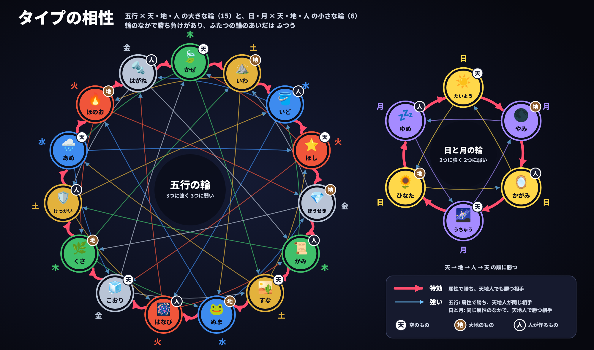

# 裏設定: タイプ

ボス・ワールド・道具を増やすときに、相性の関係がくずれないようにするための、開発用の決まりです。
2026-11-20 に「ふたつの輪」の形に決めました。**ゲームへの反映はこれから**です（いまのゲームの弱点は、まだ「相性の階段」のまま）。

## 考え方

- 属性は七曜（木・火・土・金・水・日・月）。それぞれを **天・地・人** に分ける。全部で21タイプ。
  - 天 ＝ 空のもの（現象・気象）
  - 地 ＝ 大地のもの（自然物・地形）
  - 人 ＝ 人が作る・育てるもの（技術・道具・営み）
- 五行（木・土・水・火・金）の15タイプで「五行の輪」、日と月の6タイプで「日と月の輪」を作る。
- **ふたつの輪のあいだは「ふつう」**（勝ち負けなし）。
- タイプの名前は自前のもの。ほかのゲームの相性表には合わせない（当てはめて調べた結果、3割ほどしか合わなかった）。

## 決まり

### きまり1: 属性
木 → 土 → 水 → 火 → 金 → 木（次に勝つ。「次の次」にも少し強い）

| | 見立て |
|---|---|
| 木 → 土、水 | 土に根をはり、水をすいあげる |
| 土 → 水、火 | 水をせきとめ、火をうめて消す |
| 水 → 火、金 | 火を消し、金をさびさせる |
| 火 → 金、木 | 金をとかし、木をもやす |
| 金 → 木、土 | 木を切り、土をほる |

日と月は、おたがいに勝ち合う（日 ⇄ 月）。

### きまり2: 天・地・人
天 → 地 → 人 → 天

### 相性の出し方

| | 五行の輪 | 日と月の輪 |
|---|---|---|
| 特効（効果ばつぐん） | 次の属性の、天地人でも勝つ相手 | 相手の属性の、天地人で勝つ相手 |
| 強い | 次の属性の、天地人が同じ相手／次の次の属性の、天地人が同じ相手 | 同じ属性のなかで、天地人で勝つ相手 |
| 効きにくい | 自分と同じタイプ | 自分と同じタイプ |
| ふつう | それ以外 | それ以外 |

- 五行の輪は、どのタイプも **3つに強く、3つに弱い**。特効をたどると15タイプがひとつの輪になる。
- 日と月の輪は、どのタイプも **2つに強く、2つに弱い**。特効をたどると6タイプがひとつの輪になる。

## タイプの表

### 五行の輪（15）

| 属性 | 天 | 地 | 人 |
|---|---|---|---|
| 木 | かぜ | くさ | かみ |
| 土 | すな | いわ | けっかい |
| 水 | あめ | ぬま | いど |
| 火 | ほし | ほのお | はなび |
| 金 | こおり | ほうせき | はがね |

### 日と月の輪（6）

| 属性 | 天 | 地 | 人 |
|---|---|---|---|
| 日 | たいよう | ひなた | かがみ |
| 月 | うちゅう | やみ | ゆめ |

## ぜんぶの相性

| タイプ | 席 | 特効 | 強い |
|---|---|---|---|
| かぜ | 木の天 | いわ | すな、あめ |
| くさ | 木の地 | けっかい | いわ、ぬま |
| かみ | 木の人 | すな | けっかい、いど |
| すな | 土の天 | ぬま | あめ、ほし |
| いわ | 土の地 | いど | ぬま、ほのお |
| けっかい | 土の人 | あめ | いど、はなび |
| あめ | 水の天 | ほのお | ほし、こおり |
| ぬま | 水の地 | はなび | ほのお、ほうせき |
| いど | 水の人 | ほし | はなび、はがね |
| ほし | 火の天 | ほうせき | こおり、かぜ |
| ほのお | 火の地 | はがね | ほうせき、くさ |
| はなび | 火の人 | こおり | はがね、かみ |
| こおり | 金の天 | くさ | かぜ、すな |
| ほうせき | 金の地 | かみ | くさ、いわ |
| はがね | 金の人 | かぜ | かみ、けっかい |
| たいよう | 日の天 | やみ | ひなた |
| ひなた | 日の地 | ゆめ | かがみ |
| かがみ | 日の人 | うちゅう | たいよう |
| うちゅう | 月の天 | ひなた | やみ |
| やみ | 月の地 | かがみ | ゆめ |
| ゆめ | 月の人 | たいよう | うちゅう |

## いまのワールドの席（案）

| ワールド | タイプ |
|---|---|
| 草原、フラワー | くさ |
| 砂漠 | すな |
| 氷 | こおり |
| べたべた | ぬま |
| マグマ | いわ |
| 炎 | ほのお |
| ポップコーン | はなび |
| トランポリン | はがね |
| 宇宙 | うちゅう |

空いている席: かぜ、かみ、けっかい、あめ、いど、ほし、ほうせき、たいよう、ひなた、かがみ、やみ、ゆめ。これから作るワールド用。
1つのタイプに複数のワールドがあってよい。

## これからやること

1. 日と月の輪の「強い」をどうするか決める（見立てが弱い。特効だけにする手もある）。
2. いまの10ワールドをこの表に当てはめ、ボスの弱点・段・道具が効いたときの後始末を引き直す。
3. 見立てが苦しいところを、名前かボス・道具の設定のほうで合わせる。
   - 五行の輪: ほし→かぜ、ほうせき→くさ、かぜ→いわ（特効）、はがね→かぜ（特効）
   - 日と月の輪: ゆめ→たいよう（特効）、同じ属性のなかの「強い」ぜんぶ

## 決めるまでに比べた案

| 案 | タイプ数 | やめた理由 |
|---|---|---|
| ほかのゲームの18タイプをそのまま借りる | 18 | 弱点は1つだけ、というこのゲームの形と合わない |
| 五行 × 陰陽 | 10 | 数が少ない。やみ・宇宙の席がない |
| 七曜 × 陰陽 | 14 | 月まわりに苦しい関係が多い |
| 七曜の星（曜日の順） | 14 | 覚えやすいが、常識と逆の特効が出る |
| 五行 × 天地人 ＋ ひかり・やみ | 17 | 2つだけ別枠になる（いまの形のもと） |
| 七曜 × 天地人（ひとつの輪） | 21 | 日・月と五行をまたぐ関係が苦しい |

決まりは `tests/test_types.py` が確かめる（表は `tests/types_data.py`）。
