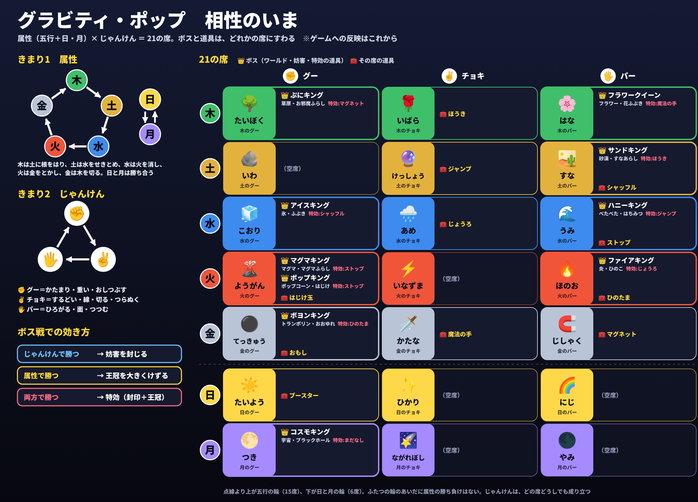

# 裏設定: タイプ

ボス・ワールド・道具を増やすときに、相性の関係がくずれないようにするための、開発用の決まりです。
2026-11-21 に「五行 × じゃんけん」の形に決めました（前日の「天・地・人」から乗りかえ）。
**ゲームへの反映はこれから**です（いまのゲームの弱点は、まだ「相性の階段」のまま）。

## 考え方

- 軸は2つ。**属性**（木・火・土・金・水・日・月）と、**じゃんけん**（グー・チョキ・パー）。全部で21タイプ。
- じゃんけんの手は、そのまま形や動きを表す。
  - ✊ グー ＝ かたまり・重い・おしつぶす
  - ✌️ チョキ ＝ するどい・線・切る・つらぬく
  - 🖐️ パー ＝ ひろがる・面・つつむ
- 五行（木・土・水・火・金）の15タイプで「五行の輪」、日と月の6タイプで「日と月の輪」を作る。
- タイプの名前は自前のもの。ほかのゲームの相性表には合わせない。

## 決まり

### きまり1: 属性
木 → 土 → 水 → 火 → 金 → 木（次に勝つ）。日と月は、おたがいに勝ち合う。五行と日・月のあいだに、属性の勝ち負けはない。

| | 見立て |
|---|---|
| 木 → 土 | 土に根をはる |
| 土 → 水 | 水をせきとめる |
| 水 → 火 | 火を消す |
| 火 → 金 | 金をとかす |
| 金 → 木 | 木を切る |

### きまり2: じゃんけん
グー → チョキ → パー → グー。じゃんけんは、輪をまたいでも成り立つ。

### ボス戦での役目（2つの軸は、べつべつの効き方をする）

| 道具がボスに | 起きること | 実況ぷに |
|---|---|---|
| じゃんけんで勝つ | 妨害を封じる（封印） | 「封じた！」 |
| 属性で勝つ | 王冠を大きくけずる | 「王冠にひびが！」 |
| 両方で勝つ（特効） | 封印 ＋ 王冠を大きくけずる | 「効果ばつぐん！！」 |
| どちらでもない | 王冠を少しけずる | 「効いてる！」 |
| 同じタイプ | ほとんど効かない | 「あまり効いてない…」 |

1体のボスに、封じられる道具・王冠をけずれる道具・両方できる道具が、それぞれいくつかある形になる。

## タイプの表

### 五行の輪（15）

| 属性 | ✊ グー | ✌️ チョキ | 🖐️ パー |
|---|---|---|---|
| 木 | たいぼく | いばら | はな |
| 土 | いわ | けっしょう | すな |
| 水 | こおり | あめ | うみ |
| 火 | ようがん | いなずま | ほのお |
| 金 | てっきゅう | かたな | じしゃく |

### 日と月の輪（6）

| 属性 | ✊ グー | ✌️ チョキ | 🖐️ パー |
|---|---|---|---|
| 日 | たいよう | ひかり | にじ |
| 月 | つき | ながれぼし | やみ |

席の名前は広い言葉。1つの席に、複数のワールドや道具が入ってよい。

## タイプどうしの相性（図の矢印）

特効 ＝ 属性で勝ち、じゃんけんでも勝つ相手。強い ＝ 五行の輪では「属性で勝ち、あいこ」と「属性が次の次で、あいこ」。日と月の輪では「同じ属性のなかで、じゃんけんで勝つ相手」。

| タイプ | 席 | 特効 | 強い |
|---|---|---|---|
| たいぼく | 木のグー | けっしょう | いわ、こおり |
| いばら | 木のチョキ | すな | けっしょう、あめ |
| はな | 木のパー | いわ | すな、うみ |
| いわ | 土のグー | あめ | こおり、ようがん |
| けっしょう | 土のチョキ | うみ | あめ、いなずま |
| すな | 土のパー | こおり | うみ、ほのお |
| こおり | 水のグー | いなずま | ようがん、てっきゅう |
| あめ | 水のチョキ | ほのお | いなずま、かたな |
| うみ | 水のパー | ようがん | ほのお、じしゃく |
| ようがん | 火のグー | かたな | てっきゅう、たいぼく |
| いなずま | 火のチョキ | じしゃく | かたな、いばら |
| ほのお | 火のパー | てっきゅう | じしゃく、はな |
| てっきゅう | 金のグー | いばら | たいぼく、いわ |
| かたな | 金のチョキ | はな | いばら、けっしょう |
| じしゃく | 金のパー | たいぼく | はな、すな |
| たいよう | 日のグー | ながれぼし | ひかり |
| ひかり | 日のチョキ | やみ | にじ |
| にじ | 日のパー | つき | たいよう |
| つき | 月のグー | ひかり | ながれぼし |
| ながれぼし | 月のチョキ | にじ | やみ |
| やみ | 月のパー | たいよう | つき |

## 席ごとのボスの能力（候補）

ボスの妨害は、席の形から選ぶ。グーは落とす・ゆらす・押しつぶす、チョキは線でつらぬく・切る・ぬいとめる、パーはおおう・つつむ・見えなくする。

| 席 | タイプ | モチーフ | 妨害（このゲームでの形） | いまのボス |
|---|---|---|---|---|
| 木のグー | たいぼく | 巨木・根のかたまり | 大きな根や幹で、出口のまわりをふさぐ（大きなお邪魔のかたまり） | ぷにキング |
| 木のチョキ | いばら | いばら・矢 | いばらのつるが線でのびて、当たったつながりを切る | — |
| 木のパー | はな | 花粉・つたのあみ・**びょうき** | 花ふぶきでおおって、盤面を見えにくくする。びょうきが、となりのぷにへうつって増える（感染ぷに） | フラワークイーン |
| 土のグー | いわ | 大岩・城壁 | 消えない大岩を落とす。壁を立てて盤面をせまくする | — |
| 土のチョキ | けっしょう | 結晶の刃・石のやり | 下からするどい結晶がつき上げ、かたまりを2つに割る | — |
| 土のパー | すな | 流砂・砂ぼこり | すなあらしでつつみ、ぷにがくっつかなくなる | サンドキング |
| 水のグー | こおり | 氷のかたまり・水の弾 | ふぶきで、ぷにを氷に閉じこめる | アイスキング |
| 水のチョキ | あめ | 雨・たき・水のカッター | 強い雨が線でふり、1列をつらぬく | — |
| 水のパー | うみ | だく流・きり・うずしお・**どく** | はちみつでつつんで、べたべたにする。うずで盤面を回す。どくのきりで、ぷにを弱らせる | ハニーキング |
| 火のグー | ようがん | 溶岩の弾・爆薬 | 溶岩のかたまりを落とす。爆発ではじき飛ばす | マグマキング、ポップキング |
| 火のチョキ | いなずま | 火の刃・レーザー | 火の線が走り、線の上のぷにを焼き切る | — |
| 火のパー | ほのお | 火の粉・けむり | 火の粉をまいて、ぷにをとかす。けむりで目かくし | ファイアキング |
| 金のグー | てっきゅう | 鉄球・よろい | 重い衝撃で、全部はね上げる。重い鉄球ぷにを落とす | ボヨンキング |
| 金のチョキ | かたな | 剣・ドリル・くさり | 斬ってつながりを切る。くさりで、ぷにをつないで動けなくする | — |
| 金のパー | じしゃく | 砂鉄・磁力のあみ | 磁力で、ぷにを一方へ引き寄せる（傾きがきかなくなる） | — |
| 日のグー | たいよう | 太陽のかたまり・フレア弾 | 熱い玉を落として、まわりのぷにを焼く | — |
| 日のチョキ | ひかり | 光線・せん光 | 光の線でつらぬく（いじわる光線。いまはどのボスも使わない） | — |
| 日のパー | にじ | にじ・まぶしい光 | ぷにの色が、入れかわって見える | — |
| 月のグー | つき | いん石・ブラックホール | 重力のかたまりが、ぷにを出口へ吸い寄せる | コスモキング |
| 月のチョキ | ながれぼし | 流れ星・かげぬい | 流れ星が線で走る。かげぬいで、ぷにをその場にぬいとめる | — |
| 月のパー | やみ | 夜・やみ・きり | 盤面が暗くなる（まわりしか見えない） | — |

### どく・びょうきの置き場

- どく ＝ 水のパー。液やきりで、しみこんでひろがる。特効は土のチョキ（土が毒を吸う）。
- びょうき ＝ 木のパー。カビやきのこのように、うつって増える。特効は金のチョキ（メス・注射の針で切りとる）。
- 「刺す毒」（ハチの針など）にするときだけ、チョキになる。

### 名前をつけるときの決まり

ゲームの中の「宝石」（ボスを倒すともらえる石）とまぎれないよう、タイプの名前には「ほうせき」を使わない（土のチョキは「けっしょう」）。

同じ属性の3つの席は、**別々のもの**にする。「たいよう・ひざし・あさ」のように、1つのものの言いかえや一部にしない。

## いまのボスと道具の割りふり（案・未反映）

ボスの手は、妨害の形で決める。道具の手は、効き方の形で決める。

### ボス

| ワールド | ボス | 席 | 妨害 | 特効の道具 | 封じるだけの道具 | 王冠をけずるだけの道具 | 同じ席（効きにくい） |
|---|---|---|---|---|---|---|---|
| 草原 | ぷにキング | 木のグー（たいぼく） | お邪魔ふらし: お邪魔のかたまりを落として、出口のまわりをふさぐ | マグネット | シャッフル、ストップ、ひのたま | 魔法の手、おもし | — |
| 砂漠 | サンドキング | 土のパー（すな） | すなあらし: 砂でつつみ、くっつかなくする | ほうき | じょうろ、魔法の手、ジャンプ | — | シャッフル |
| 氷 | アイスキング | 水のグー（こおり） | ふぶき: 氷のかたまりに閉じこめる | シャッフル | ストップ、ひのたま、マグネット | ジャンプ | — |
| フラワー | フラワークイーン | 木のパー（はな） | 花ふぶき: 花粉でおおって目かくし | 魔法の手 | ほうき、じょうろ、ジャンプ | おもし、マグネット | — |
| べたべた | ハニーキング | 水のパー（うみ） | はちみつ: つつんでべたべたにする | ジャンプ | ほうき、じょうろ、魔法の手 | シャッフル | ストップ |
| マグマ | マグマキング | 火のグー（ようがん） | マグマふらし: 溶岩のかたまりを落とす | ストップ | シャッフル、ひのたま、マグネット | じょうろ | はじけ玉 |
| 炎 | ファイアキング | 火のパー（ほのお） | ひのこ: 火の粉をまいて、とかす | じょうろ | ほうき、魔法の手、ジャンプ | ストップ | ひのたま |
| ポップコーン | ポップキング | 火のグー（ようがん） | はじけ: 爆発ではじき飛ばす | ストップ | シャッフル、ひのたま、マグネット | じょうろ | はじけ玉 |
| トランポリン | ボヨンキング | 金のグー（てっきゅう） | おおゆれ: 重い衝撃で、全部はね上げる | ひのたま | シャッフル、ストップ、マグネット | はじけ玉 | おもし |
| 宇宙 | コスモキング | 月のグー（つき） | ブラックホール: 重力のかたまりで吸い寄せる | （まだない） | シャッフル、ストップ、ひのたま、マグネット | ブースター | — |

### 道具

| 道具 | 席 |
|---|---|
| ブースター | 日のグー（たいよう） |
| ほうき | 木のチョキ（いばら） |
| シャッフル | 土のパー（すな） |
| ストップ | 水のパー（うみ） |
| じょうろ | 水のチョキ（あめ） |
| 魔法の手 | 金のチョキ（かたな） |
| おもし | 金のグー（てっきゅう） |
| ひのたま | 火のパー（ほのお） |
| はじけ玉 | 火のグー（ようがん） |
| ジャンプ | 土のチョキ（けっしょう） |
| マグネット | 金のパー（じしゃく） |

- 宝石から作れる道具の対応（草原の宝石→ほうき、など）は、いまのまま変えない案。
- 宇宙のボス（月のグー）には、まだ特効の道具がない（日のパーの道具を、これから作る）。
- いまのボスは、グーが6体、パーが4体、チョキが0体。グーの道具（おもし・はじけ玉・ブースター）で封じられる相手が、まだいない。これから作るボスは、チョキの席（けっしょう・あめ・いなずま・かたな・ひかり・ながれぼし）を優先する。
- マグマとポップコーンは同じ席（火のグー）なので、効く道具も同じになる。
- ひのたま（火のパー）は、アイスキング（水のグー）を封じられるが、王冠は大きくけずれない。五行では水が火に勝つため。

### 段

段は2つだけにする（2026-11-21）。あまり整えすぎない。

- 1段目: 草原・砂漠・氷（まずはここから）
- 2段目: それ以外ぜんぶ
- 段ごとのボスの体力の差は、まだつけない。

## これからやること

1. 上の割りふり案を確認して、ゲームに入れる（弱点・段・後始末・実況ぷにのセリフ）。
2. 日と月の輪の「強い」をどうするか決める（特効だけにする手もある）。
3. 見立てが苦しいところを、名前かボス・道具の設定のほうで合わせる。

## 決めるまでに比べた案

| 案 | タイプ数 | やめた理由 |
|---|---|---|
| ほかのゲームの18タイプをそのまま借りる | 18 | 弱点は1つだけ、というこのゲームの形と合わない。相性も3割ほどしか合わない |
| 五行 × 陰陽 | 10 | 数が少ない。やみ・宇宙の席がない |
| 七曜 × 陰陽 | 14 | 月まわりに苦しい関係が多い |
| 七曜の星（曜日の順） | 14 | 覚えやすいが、常識と逆の特効が出る |
| 七曜 × 天地人（ひとつの輪） | 21 | 日・月と五行をまたぐ関係が苦しい |
| 五行・日月 × 天地人（ふたつの輪） | 21 | 「天は地に勝つ」に常識がない。じゃんけんのほうが、だれでも知っていて、形と動きに落としやすい |

決まりは `tests/test_types.py` が確かめる（表は `tests/types_data.py`）。
