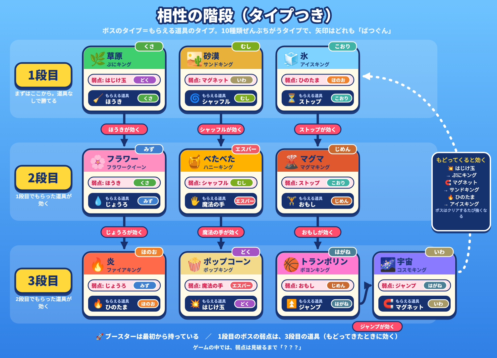

# 裏設定: タイプ

ボス・ワールド・アイテムを増やすときに、相性の関係がくずれないようにするための、開発用の覚え書きです。
ゲームの中や公式Wikiには出しません（タイプ名は他社のゲームの相性表を借りた、内部の目印です）。

## 決まり

1. ワールド（ボス）は、タイプを1つ持つ。
2. ボスの宝石から作る道具は、**そのボスと同じタイプ**になる。
3. ボスの弱点は、**そのボスのタイプに「ばつぐん」なタイプの道具**にする。
4. タイプは、ワールドごとに**ちがうもの**にする（同じタイプを2つ作らない）。
5. ゲームの中の正は、あくまで `COUNTER`（ボス→弱点の道具）と `GEM_ITEM`（宝石→道具）。タイプは、それを決めるときの物差し。
   ゲームでは弱点は1つだけなので、相性表で「ばつぐん」になるほかの組み合わせは、ゲームには反映しない。

この決まりは `tests/test_types.py` が確かめる。ワールドや道具を足したら、下の表と `tests/types_data.py` の両方に足すこと。

## いまの割り当て

| 段 | ワールド | ボス | タイプ | 宝石で作る道具 | 弱点の道具（タイプ） | 見立て |
|---|---|---|---|---|---|---|
| 1 | 草原 | ぷにキング | くさ | ほうき | はじけ玉（どく） | 草ぼうき |
| 1 | 砂漠 | サンドキング | むし | シャッフル | マグネット（いわ） | アリジゴクのうず |
| 1 | 氷 | アイスキング | こおり | ストップ | ひのたま（ほのお） | 凍らせて止める |
| 2 | フラワー | フラワークイーン | みず | じょうろ | ほうき（くさ） | 花に水 |
| 2 | べたべた | ハニーキング | エスパー | 魔法の手 | シャッフル（むし） | 念力の手 ※ |
| 2 | マグマ | マグマキング | じめん | おもし | ストップ（こおり） | 溶岩・重い石 |
| 3 | 炎 | ファイアキング | ほのお | ひのたま | じょうろ（みず） | そのまま |
| 3 | ポップコーン | ポップキング | どく | はじけ玉 | 魔法の手（エスパー） | ※ |
| 3 | トランポリン | ボヨンキング | はがね | ジャンプ | おもし（じめん） | ばね |
| 3 | 宇宙 | コスモキング | いわ | マグネット | ジャンプ（はがね） | いん石・磁石は石 |

勝つ順: くさ → みず → ほのお → こおり → じめん → はがね → いわ → むし → エスパー → どく → くさ

※ 見立てが不自然なところ（べたべた＝エスパー、ポップコーン＝どく）。あとで、ボスや道具の見た目・設定のほうを合わせる。

## まだ使っていないタイプ

ノーマル・でんき・かくとう・ひこう・ゴースト・ドラゴン・あく・フェアリー。
新しいワールドを足すときは、ここから選び、決まり3が成り立つ相手（弱点になる道具）を先に決める。
ブースター（最初から持っている）とエネルギー缶には、タイプはない。
